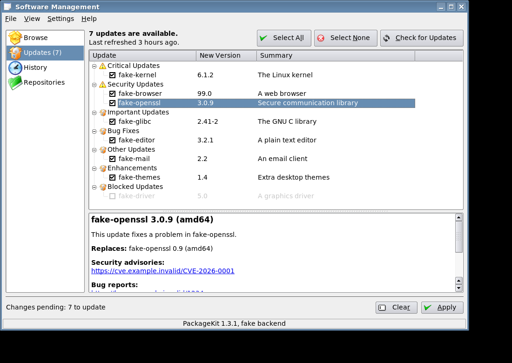

# TDE PackageKit

A native software manager for the [Trinity Desktop Environment](https://www.trinitydesktop.org/),
built on [PackageKit](https://www.freedesktop.org/software/PackageKit/). Its one-window layout
follows Apper, and its package list and details pane follow gnome-packagekit.

> [!WARNING]
> **This project is vibe-coded.** It was written by an AI (Claude Code) under human direction, and
> nobody has reviewed the code line by line. It has automated tests, but it has not had much use on
> real Trinity desktops. This program installs and removes system software, so a bug could damage
> your system. Read the code first if that matters to you, keep backups, and use it at your own risk.
> It comes with no warranty.



## Features

- Search and browse packages by name, description, file or category
- Queue installs, removals and updates, then apply them together
- See any extra dependencies and removals before anything changes
- Review updates by severity, with changelogs and security advisories
- See the history of software changes, and turn repositories on or off
- Get a tray notification when updates are available (it never installs on its own)
- Install a `.deb` by opening it
- Prompts for license agreements, unknown signing keys, unverified packages and restarts

## Quick start

Everything builds and runs in Docker, so nothing is installed on your computer:

```sh
./dk build        # compile
./dk test         # run all the tests
./dk deb          # build the Debian package into dist/
```

To install the package on Debian 13 with Trinity 14.1:

```sh
sudo apt install ./dist/tdepackagekit-trinity_*.deb
```

## Documentation

- [User guide](doc/user-guide.md)
- [Building and packaging](doc/building.md)
- [Architecture](doc/architecture.md)
- [Testing](doc/testing.md)

## License

GPL-2.0-or-later. See [debian/copyright](debian/copyright).

Maintained by [Yjlion](https://github.com/Yjlion).
