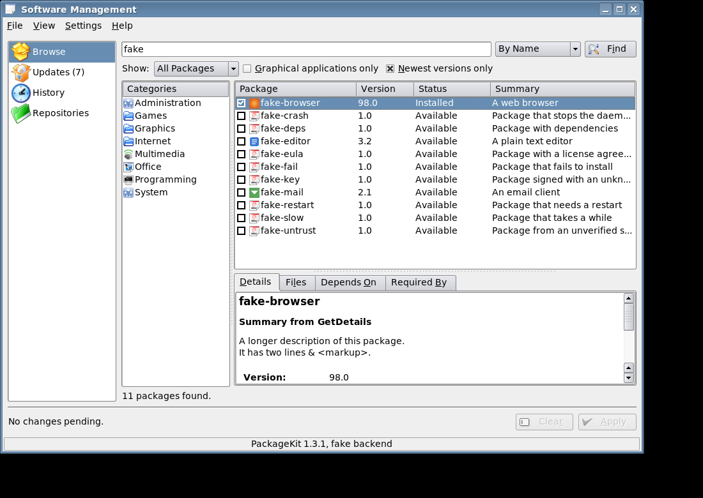
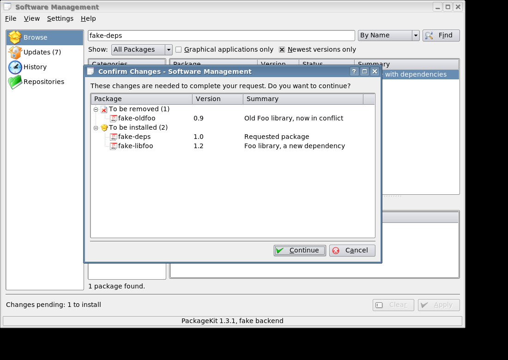
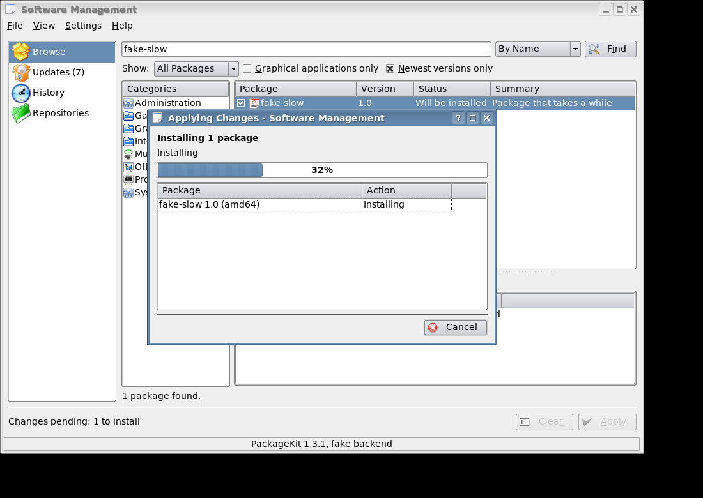
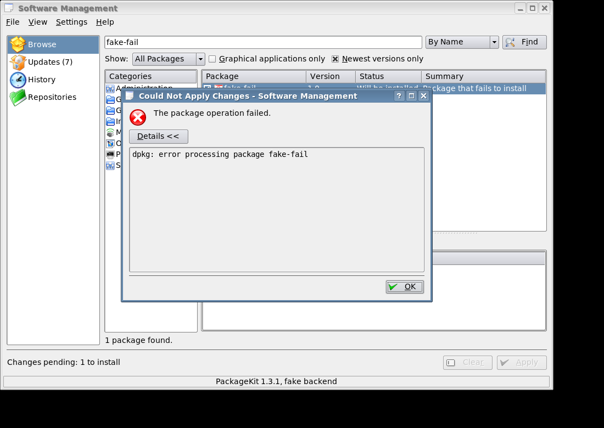
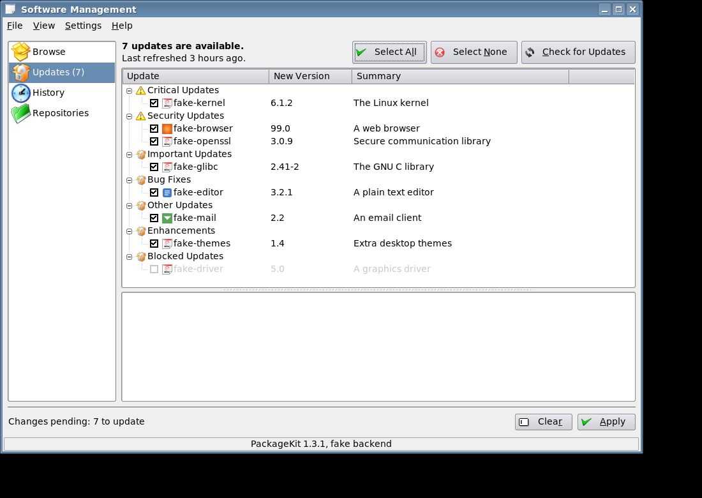
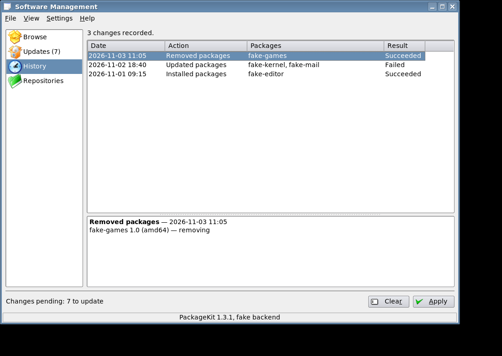
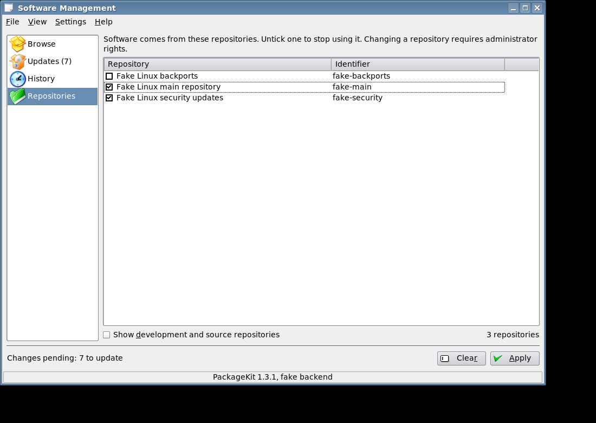
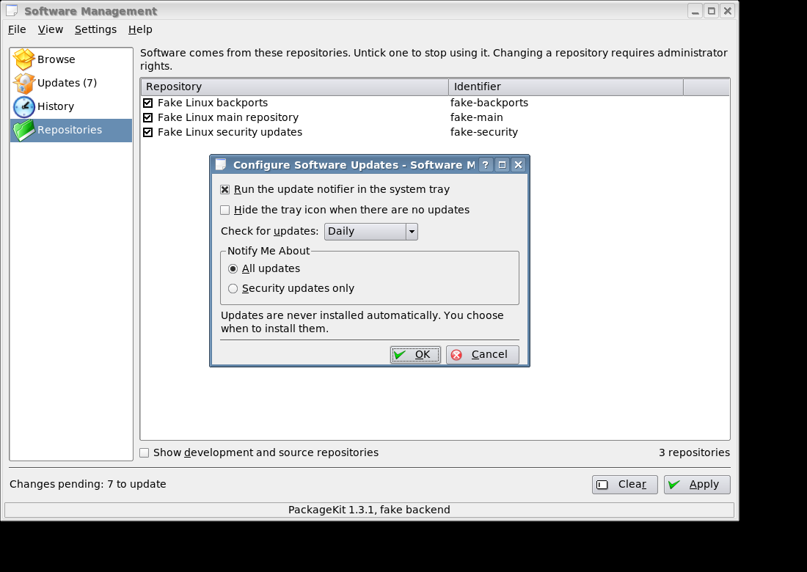

# User guide

Open **Software Management** from the Trinity menu, or run `tdepackagekit`. The sidebar switches
between four pages (or press Ctrl+1 to Ctrl+4). The bar at the bottom shows your pending changes.

The screenshots come from the test suite, which is why the packages are called `fake-*`.

The same guide is in KHelpCenter: choose **Help > Software Management Handbook**, or open
`help:/tdepackagekit`. For the command line, see `man tdepackagekit` and
`man tdepackagekit-notifier`.

## Browse



Type in the search box and press Enter, or click a category. Use the list next to the search box
to search by name, description or file name. The filters narrow the results; a filter is hidden
if your package system doesn't support it.

Select a package to see its details, files, what it depends on and what requires it.

- Tick a package to install it.
- Untick an installed package to remove it.

Nothing changes until you press **Apply**. You can keep browsing and tick more first, and
**Clear** drops every pending change.

### Application icons

The lists show each application's icon if one of these packages is installed:

- `apt-config-icons`: 48 and 64 pixel icons
- `apt-config-icons-large`: also 128 pixel icons

They make apt download the icons from Debian's AppStream data. After installing one, refresh the
package information (**File > Check for Updates**, or `sudo apt update`) and restart Software
Management. Packages that aren't applications, such as libraries, get a generic package icon.
Without either package, the lists have no icons.

## Applying changes

Pressing **Apply** first checks what will happen, without changing anything. A confirmation appears
if other packages are affected, if anything will be removed, or if you are mixing installs and
updates:



Then the changes run with a progress window. **Cancel** is available while the package system
allows it:



You may be asked for your password. That prompt comes from the Trinity authentication agent
(the `polkit-agent-tde` package). Without a running agent, changes fail with a "not authorized" error.

If something fails, the changes that didn't happen stay pending so that you can try again.



The error message has a **Details** button with the full report from the package system, such as
`dpkg`'s output. Resize or maximize the window to read long reports; it remembers the size.

Depending on the packages, you may also see:

| Prompt | What it means |
|---|---|
| [License Agreement](../screenshots/license-agreement.png) | The package has terms you must accept. Continue stays disabled until you tick the box. |
| [Trust This Software Source?](../screenshots/signature-prompt.png) | The package is signed with an unknown key. Check the fingerprint first. Pressing Enter cancels. |
| [Unverified Software](../screenshots/unverified-software.png) | The package's origin can't be checked. Every local `.deb` file shows this. |
| [Restart Required](../screenshots/restart-required.png) | Log out or restart to finish the update. |

## Updates



Updates are grouped by severity, with critical and security updates first. The first time you open
this page in a session, every update is ticked, so **Apply** installs them all. Untick any you
want to skip, or use **Select None**. Blocked updates can't be ticked.

**Check for Updates** downloads fresh package information. The sidebar shows how many updates
are waiting.

## History



Lists what was installed, removed and updated, and whether it worked. Select a row to see its
packages.

## Repositories



Untick a repository to stop using it. Adding repositories isn't offered, because PackageKit has no
general way to do it. On Debian, add them with `apt` or by editing `/etc/apt/sources.list.d/`.

## Update notifier

The notifier starts when you log in and puts an icon in the system tray. Its tooltip says whether
updates are available, and a message pops up when new ones arrive. Click the icon to open the
Updates page, or right-click it to check now or change settings. It waits about two minutes after
login before its first check.

If you'd rather have no icon while there's nothing to install, turn on **Hide the tray icon when
there are no updates** in the settings. To see whether the notifier is running, use
`pgrep -a tdepackagekit-notifier`.

It only tells you about updates. **It never installs anything by itself.**

## Settings



Open **Settings > Configure Software Management**. You can:

- turn the notifier off (turning it back on starts it at once)
- hide its icon while there are no updates
- set how often to check: every 6 hours, daily, weekly, monthly or never
- limit notifications to security updates

## Installing a package file

Open a `.deb` from Konqueror, or run:

```sh
tdepackagekit --install-file ./some-package.deb
```

You'll see what it will change, and a warning that local files can't be verified.

## Command line

| Option | Effect |
|---|---|
| `--updates` | Open the Updates page |
| `--settings` | Open the settings dialog |
| `--install-file <file>` | Install a package file |

If the app is already open, these act on the open window.
